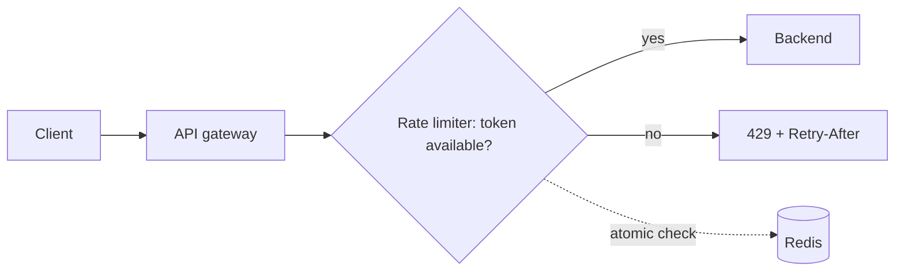

## 1. Core Concept

**Rate limiting** giới hạn số request một client được gửi trong một khoảng thời gian để **bảo vệ hệ thống khỏi quá tải, lạm dụng và chi phí**, đồng thời đảm bảo công bằng giữa các client. Nó trả lời "ai được dùng bao nhiêu" chứ không phải "hệ thống còn chịu được bao nhiêu" (đó là load shedding/backpressure). Mental model: *một cái cổng có số lượt cho phép — thuật toán quyết định cổng mở thế nào theo thời gian.*

## 2. How It Works

- **Fixed window counter**: đếm theo cửa sổ cố định (ví dụ mỗi phút). Đơn giản, nhưng **burst gấp đôi ở ranh giới** cửa sổ (100 request cuối phút + 100 đầu phút kế tiếp).
- **Sliding window log**: lưu timestamp từng request, đếm trong cửa sổ trượt — chính xác nhưng tốn bộ nhớ.
- **Sliding window counter**: ước lượng bằng cách kết hợp cửa sổ hiện tại và trước đó theo tỉ lệ — gần đúng, rất nhẹ.
- **Token bucket**: xô chứa tối đa `B` token, nạp `r` token/giây, mỗi request lấy một token. **Cho phép burst tới `B`** rồi giữ tốc độ trung bình `r`. Rất phổ biến (API gateway, AWS, Stripe).
- **Leaky bucket**: request vào hàng đợi và "rỉ" ra với tốc độ cố định — làm **mượt đầu ra**, hợp khi cần tốc độ đều tới backend.
- **Phân tán**: lưu bộ đếm ở **Redis**; thao tác kiểm tra-và-trừ phải **nguyên tử** (lệnh `INCR` + `EXPIRE`, hoặc **Lua script**).
- **Khoá theo**: API key/user (công bằng nhất), IP (dễ giả mạo, sai với NAT), endpoint hoặc tenant; có thể nhiều tầng giới hạn.
- **Phản hồi**: `429 Too Many Requests` kèm `Retry-After` và header cho biết hạn mức còn lại.

```lua
-- Token bucket nguyên tử trong Redis (KEYS[1]=bucket, ARGV=rate, burst, now, cost)
local d = redis.call('HMGET', KEYS[1], 'tokens', 'ts')
local tokens = tonumber(d[1]) or tonumber(ARGV[2]); local ts = tonumber(d[2]) or tonumber(ARGV[3])
tokens = math.min(tonumber(ARGV[2]), tokens + (tonumber(ARGV[3]) - ts) * tonumber(ARGV[1]))
if tokens >= tonumber(ARGV[4]) then tokens = tokens - tonumber(ARGV[4]); allowed = 1 else allowed = 0 end
redis.call('HSET', KEYS[1], 'tokens', tokens, 'ts', ARGV[3]); redis.call('EXPIRE', KEYS[1], 60)
return allowed
```

## 3. Visual Diagram



## 4. Rules of Thumb & Trade-offs

- Cho phép burst hợp lý (đa số API) → **token bucket**; cần đầu ra đều → **leaky bucket**; đơn giản, chấp nhận burst biên → fixed window.
- Đặt limiter ở **biên** (gateway/edge) để chặn sớm, và thêm giới hạn **theo dịch vụ** cho tài nguyên đắt.
- Trade-off: **Độ chính xác vs. chi phí/độ trễ** (sliding log chính xác nhất nhưng tốn nhất); **fail-open** (khi limiter hỏng vẫn cho qua) ưu tiên sẵn sàng, **fail-closed** ưu tiên bảo vệ.

## 5. Must Remember / Production Pitfalls

- **Race condition**: `GET` bộ đếm rồi `SET` không nguyên tử cho phép vượt hạn mức khi đồng thời → Lua/atomic.
- **Limiter là điểm lỗi duy nhất**: Redis chết thì sao? Quyết định fail-open/closed có chủ đích và có fallback cục bộ.
- Giới hạn theo **IP** sai với người dùng sau NAT/CGNAT; kẻ tấn công xoay IP.
- Client **retry ngay** khi bị 429 làm tình hình tệ hơn → backoff + jitter, tôn trọng `Retry-After`.
- Interview trap: "Fixed window có vấn đề gì?" → **burst gấp đôi tại ranh giới cửa sổ**.

## 6. Search Hooks

- `rate limiting algorithms token bucket leaky bucket` — các thuật toán giới hạn tốc độ.
- `sliding window counter rate limiter` — xấp xỉ cửa sổ trượt tiết kiệm bộ nhớ.
- `distributed rate limiter Redis Lua` — giới hạn phân tán với thao tác nguyên tử.
- `HTTP 429 Retry-After RateLimit headers` — cách báo hạn mức cho client.
- `load shedding vs rate limiting` — phân biệt bảo vệ hệ thống và công bằng giữa client.
- `fail open vs fail closed` — hành vi khi limiter gặp sự cố.
